

 

🌍 <strong>Доступно на:</strong>
&nbsp;&nbsp;|&nbsp;&nbsp;
&nbsp;&nbsp;|&nbsp;&nbsp;
&nbsp;&nbsp;|&nbsp;&nbsp;

---

  Velichka Atanasova · Будущий специалист по разработке приложений | AI-FIRST Development | Веб-разработка | SaaS-проекты

## 🧭 Краткий обзор

**Краткий профиль:** Я будущий специалист по разработке приложений с опытом в веб-дизайне и графическом дизайне. Мой фокус — современная веб-разработка, приложения с ИИ, SaaS-проекты и практическая разработка ПО. Я активно использую ИИ для планирования, понимания кода, поиска ошибок, рефакторинга, документации и структурированной разработки.

- Обучение: будущий специалист по разработке приложений (IHK Штутгарт)
- Фокус: AI-FIRST Development, современная веб-разработка, SaaS и приложения с ИИ
- Практика: собственные SaaS- и клиентские проекты с четкой структурой и документированными процессами
- Подход: планирование с ИИ, дебаггинг, рефакторинг и чистая документация
- Опыт: веб-дизайн и графический дизайн для последовательного UI/UX и ясной коммуникации

## 📚 Содержание

	
<em>Показать/скрыть содержание</em>

<table style="border-collapse:collapse;margin:0;width:100%;table-layout:auto;">
	<tr>
		<td align="left" style="padding:0 8px; vertical-align: top;">
		  <ul style="list-style:none; padding:0; margin:0; white-space:nowrap;">
		    <li>🧭 <a href="#kurzueberblick">Краткий обзор</a></li>
		    <li>🎯 <a href="#schwerpunkte">Фокусные направления</a></li>
        <li>🧪 <a href="#aktueller-fokus">Текущий фокус</a></li>
		    <li>📸 <a href="#screenshots">Скриншоты</a></li>
		    <li>🛠️ <a href="#techstack">Тех‑стек</a></li>
		  </ul>
		</td>
		<td align="left" style="padding:0 8px; vertical-align: top;">
		  <ul style="list-style:none; padding:0; margin:0; white-space:nowrap;">
		    <li>🚀 <a href="#projekte">Проекты (выбор)</a>
		      <ul style="list-style:none; padding-left:0.75rem; margin:6px 0 0 0; white-space:nowrap;">
            <li>🤖 <a href="#business-ai-hub">Business AI Hub</a></li>
            <li>💬 <a href="#voveliva">VOVELIVA</a></li>
            <li>🌐 <a href="#veli-webdesign">Veli Webdesign</a></li>
            <li>🧩 <a href="#veli-workflow">Veli Workflow</a></li>
            <li>🏗️ <a href="#venkov-stroi">Venkov Stroi</a></li>
            <li>🚀 <a href="#next-layer-ai">Next Layer AI Platform</a></li>
            <li>🎮 <a href="#labyrinth">Labyrinth (по желанию)</a></li>
		      </ul>
		    </li>
		  </ul>
		</td>
		<td align="left" style="padding:0 8px; vertical-align: top;">
		  <ul style="list-style:none; padding:0; margin:0; white-space:nowrap;">
		    <li>🎨 <a href="#design">Графический дизайн – Галерея</a></li>
		    <li>🌐 <a href="#webdesign">Веб‑дизайн – Галерея</a></li>
		    <li>📜 <a href="#zertifikate">Сертификаты</a></li>
		    <li>📈 <a href="#stats">GitHub‑статистика</a></li>
		    <li>🤝 <a href="#kontakt">Контакты</a></li>
		  </ul>
		</td>
	</tr>
 
 </table>

 

## 🎯 Фокусные направления

 

 

 

## 🧪 Текущий фокус

- Целенаправленно углублять знания по React, Node.js, GraphQL и MongoDB
- Улучшать AI-FIRST рабочий процесс
- Развивать Business AI Hub
- Строить современные веб‑ и SaaS‑проекты

## 🛠️ Тех‑стек

- Фронтенд: HTML, CSS, JavaScript, TypeScript (основы), React (основы)
- Бэкенд / Данные: Python, FastAPI (основы), PHP, SQL, REST API, базы данных
- Мобильные / Приложения: Flutter (основы)
- Другие технологии: Java, C#, Unity
- Дизайн: Adobe Creative Suite, основы UI/UX, веб‑дизайн
- Инструменты: VS Code, GitHub, инструменты разработки с ИИ

<!-- Ordered Tech Stack -->

## 🚀 Проекты (выбор)

<table style="width:100%; max-width:1100px;">
  <tr>
    <td width="300" align="center">
      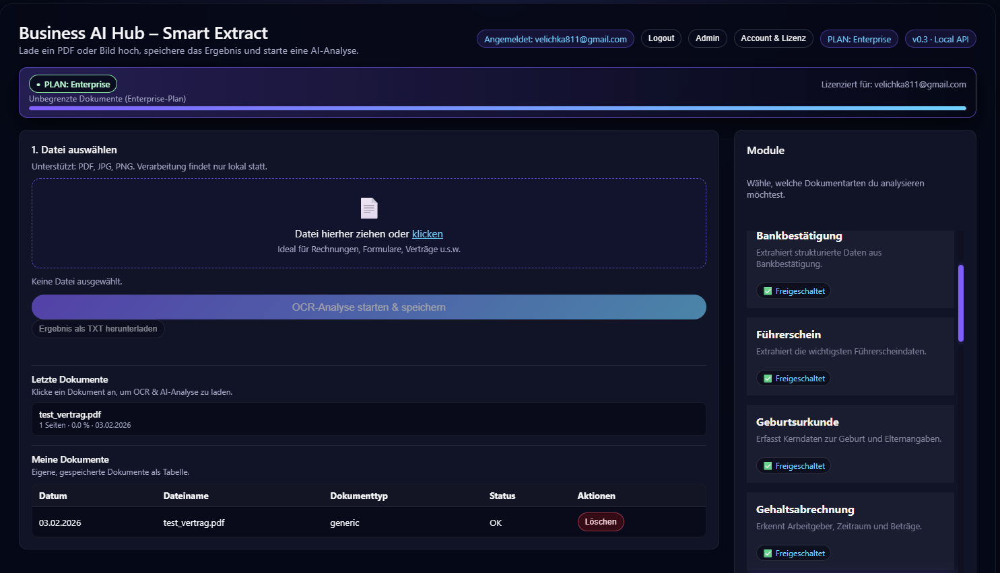
    </td>
    <td align="left">
      
      <strong>🤖 Business AI Hub</strong>
      
       
      Собственный SaaS‑проект для ИИ‑анализа документов с загрузкой документов, ИИ‑анализом, структурированными результатами, историей, экспортом PDF, модульной и лицензионной логикой. 
      <em>SaaS · ИИ анализ · Веб‑разработка · Бэкенд/API · Документация</em> 
      <a href="https://www.business-ai-hub.net">https://www.business-ai-hub.net</a>
    </td>
  </tr>
  <tr>
    <td width="300" align="center">
      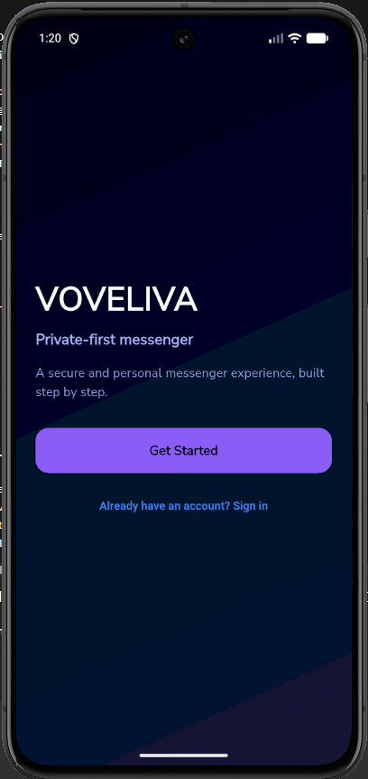
    </td>
    <td align="left">
      
      <strong>💬 VOVELIVA</strong>
      
       
      Мессенджер с приоритетом приватности: вход, список чатов, сообщения, изображения, голосовые сообщения и многоязычность. 
      <em>Flutter · FastAPI · Auth · Messaging · Многоязычность</em> 
      Публичной ссылки нет
    </td>
  </tr>
  <tr>
    <td width="300" align="center">
      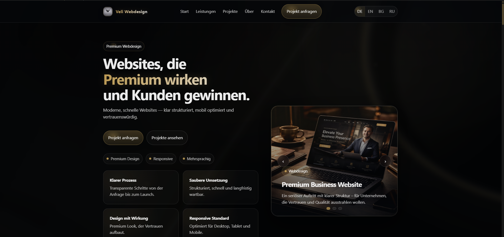
    </td>
    <td align="left">
      
      <strong>🌐 Veli Webdesign</strong>
      
       
      Собственные и клиентские веб‑проекты с современными адаптивными сайтами, лендингами, основами UI/UX и чистой фронтенд‑реализацией. 
      <em>HTML · CSS · JavaScript · UI/UX · Адаптивный дизайн</em> 
      <a href="https://www.veli-webdesign.com">https://www.veli-webdesign.com</a>
    </td>
  </tr>
  <tr>
    <td width="300" align="center">
      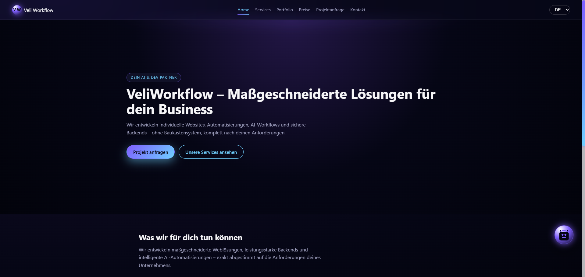
    </td>
    <td align="left">
      
      <strong>🧩 Veli Workflow</strong>
      
       
      Собственная платформа проектов и рабочих процессов для презентации программных, веб‑дизайн‑ и ИИ‑проектов. 
      <em>Web · Структура проектов · Брендинг · Workflow · Платформа</em> 
      <a href="https://www.veli-workflow.com">https://www.veli-workflow.com</a>
    </td>
  </tr>
  <tr>
    <td width="300" align="center">
      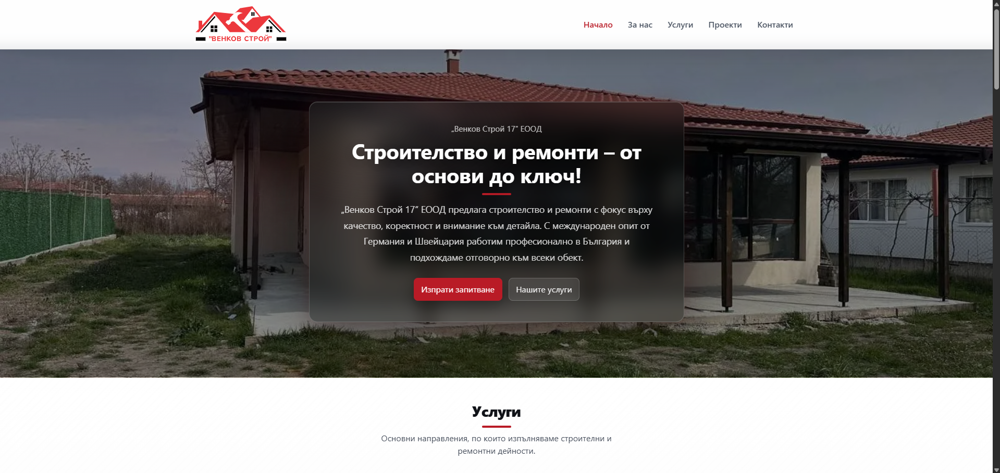
    </td>
    <td align="left">
      
      <strong>🏗️ Venkov Stroi</strong>
      
       
      Клиентский проект для болгарской строительной компании: страницы услуг, раздел проектов, галерея, страница команды, контактная форма и базовое SEO. 
      <em>Веб‑дизайн · Адаптивный дизайн · Клиентский проект · Базовое SEO</em> 
      <a href="https://www.venkov-stroi.com">https://www.venkov-stroi.com</a>
    </td>
  </tr>
  <tr>
    <td width="300" align="center">
      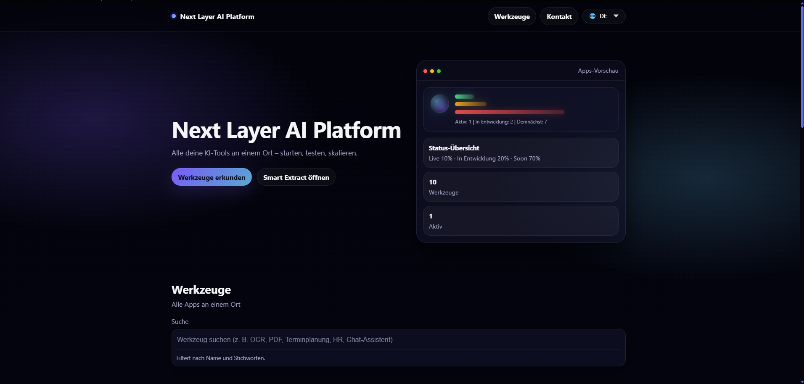
    </td>
    <td align="left">
      
      <strong>🚀 Next Layer AI Platform</strong>
      
       
      Платформа для презентации и структурирования нескольких AI/SaaS‑инструментов и лендинг‑страниц. 
      <em>AI/SaaS · Лендинги · Обзор инструментов · Веб‑структура · SEO</em> 
      <a href="https://www.next-layer-ai-platform.com">https://www.next-layer-ai-platform.com</a>
    </td>
  </tr>
  <tr>
    <td width="300" align="center">
      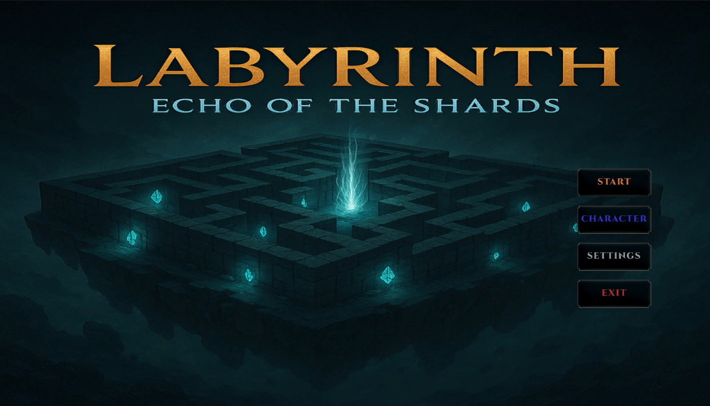
    </td>
    <td align="left">
      
      <strong>🎮 Labyrinth: Echo of the Shards</strong>
      
       
      Игровой проект на Unity/C# с механиками лабиринта, врагами, ловушками, системой ключей и процедурными элементами. 
      <em>Unity · C# · Game Development · Процедурные уровни · Учебный проект</em> 
      <a href="Labyrinth-Echo-of-the-Shards/">Labyrinth-Echo-of-the-Shards/</a>
    </td>
  </tr>
</table>

## 🎨 Графический дизайн – Галерея

<table>
    <tr>
    <td >
            <a href="certificates/docs/grafikdesigner-2022.pdf">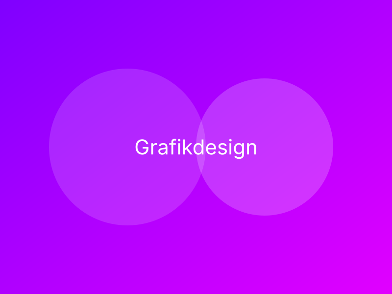</a>
             Графический дизайн 1
        </td>
    <td >
            <a href="certificates/docs/grafikdesigner-2022.pdf">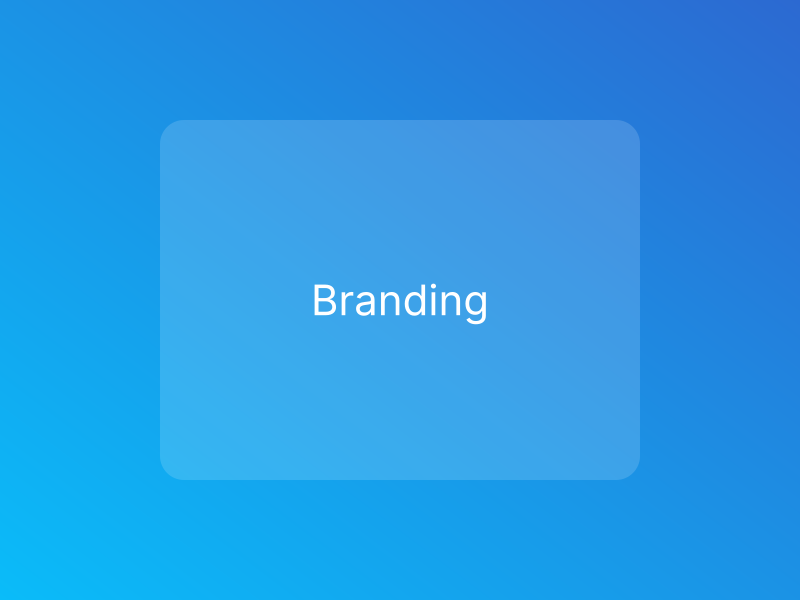</a>
             Графический дизайн 2
        </td>
    <td >
            <a href="certificates/docs/grafikdesigner-2022.pdf">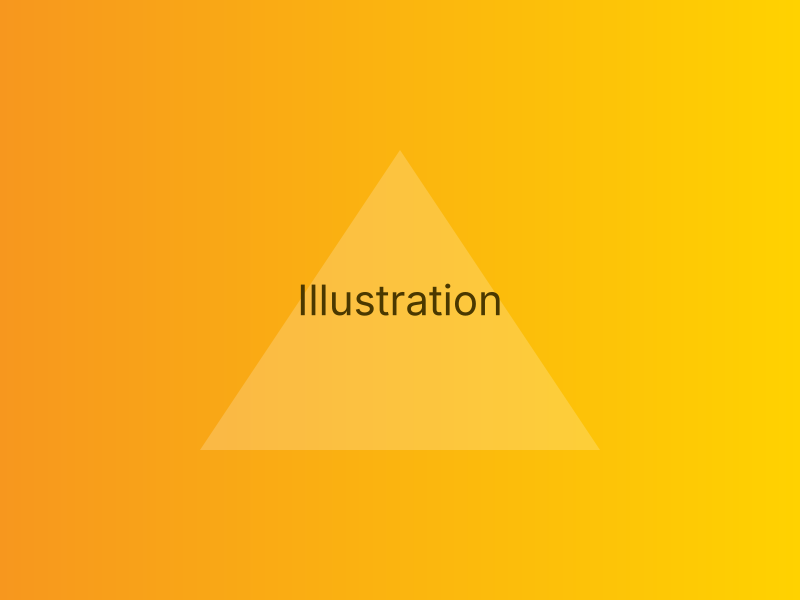</a>
             Графический дизайн 3
        </td>
    </tr>
  
</table>

> Совет: смотрите также подпроект в этом репозитории: `Labyrinth-Echo-of-the-Shards/`.

## 🌐 Веб‑дизайн – Галерея

<table>
    <tr>
    <td >
            <a href="certificates/docs/webdesigner-2024.pdf">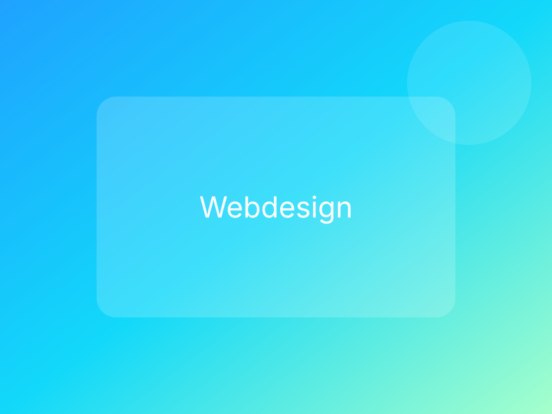</a>
             Веб‑дизайн 1
        </td>
    <td >
            <a href="certificates/docs/webdesigner-2024.pdf">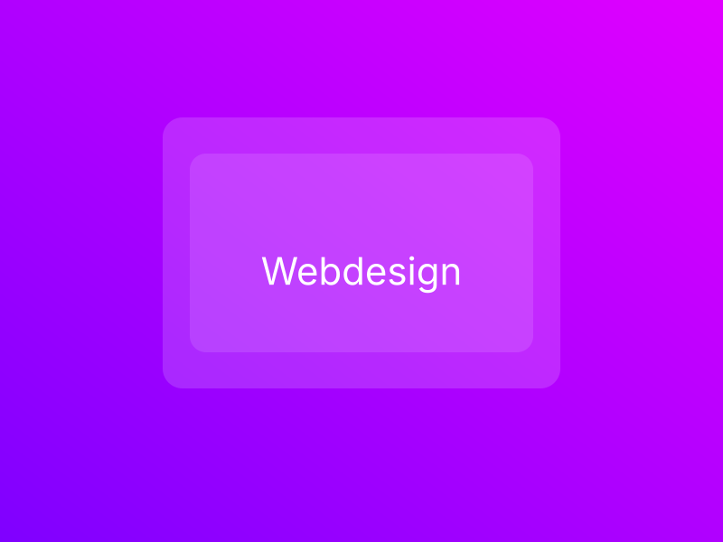</a>
             Веб‑дизайн 2
        </td>
    <td >
            <a href="certificates/docs/webdesigner-2024.pdf">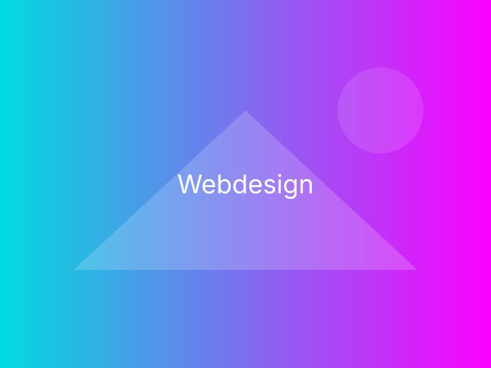</a>
             Веб‑дизайн 3
        </td>
    </tr>
  
</table>

## 📜 Сертификаты

- 🏆 Графический дизайнер (2022)
- 🖌️ Компьютерный график (2023)
- 💻 Веб‑дизайнер (2024)
- 👩‍💻 Специалист по разработке приложений (с 2024, IHK Штутгарт)
- 🐍 Основы Python и SQL (2025)
- 📈 Scrum (2025)

➡️ [Посмотреть все сертификаты](https://github.com/Velichka81/certificates)

## 📈 GitHub‑статистика

## 🤝 Контакты

- 📫 Email: velichka811@gmail.com
- 🌐 Сайт: https://www.veli-webdesign.com
- 🧩 Workflow: https://www.veli-workflow.com
- 💼 LinkedIn: https://www.linkedin.com/in/velichka-atanasova-32781a227
- 🧑‍💻 GitHub: https://github.com/Velichka81
- 📍 Местоположение: Штутгарт, Германия

